# EngineMind AI — Turbofan Engine Degradation & RUL Prognostics

[](https://dlamlproject-app.vercel.app/)
[](https://www.python.org/)
[](https://xgboost.readthedocs.io/)
[](https://data.nasa.gov/)
[](LICENSE)

> **Live Interactive Web Application:** [https://dlamlproject-app.vercel.app/](https://dlamlproject-app.vercel.app/)  
> EngineMind AI provides end-to-end Remaining Useful Life (RUL) estimation and fleet health monitoring for high-bypass turbofan engines simulated under the NASA C-MAPSS benchmark.

---

## 📌 Executive Summary

Predictive maintenance in commercial aviation demands accurate, early degradation detection to avoid catastrophic in-flight engine failures while eliminating premature, cost-prohibitive overhauls. 

**EngineMind AI** addresses this challenge using the **NASA C-MAPSS (Commercial Modular Aero-Propulsion System Simulation) FD001** benchmark:
- **100 run-to-failure engines** for training ($20{,}631$ operational cycles).
- **100 held-out test engines** with truncated sensor histories.
- **Single operating condition** (Sea-Level) and **single dominant failure mode** (High-Pressure Compressor [HPC] degradation).

By combining multi-scale rolling temporal feature extraction, piece-wise degradation target capping ($125$ cycles), leak-free engine-grouped cross-validation, and hyperparameter-tuned gradient boosted decision trees (**XGBoost**), EngineMind AI achieves a final held-out test **MAE of 12.81 cycles** ($R^2 = 0.791$, NASA Asymmetric Score = $1459.55$). Crucially, for critical engines nearing failure ($\le 30$ cycles), prediction accuracy sharpens to an **MAE of 9.92 cycles**.

---

## 👥 Team & Member Responsibilities

The project was executed by a 5-member team with specialized ownership spanning the entire machine learning and software engineering lifecycle:

| Member # | Name | Core Area | Presentation & Technical Responsibility | Primary Artifacts & Code |
| :---: | :--- | :--- | :--- | :--- |
| **1** | **MS Thejas** | **Data Preparation** | NASA dataset, loading, preprocessing, exploration | `src/data_loader.py`<br>`src/explore_data.py`<br>`src/preprocessing.py`<br>`reports/engine_lifetimes.png`<br>`reports/sensor_variability.png` |
| **2** | **Deepak Pandey** | **Model Experiments** | Baselines, feature selection, target comparison, cross-validation | `src/compare_features.py`<br>`src/compare_targets.py`<br>`src/compare_models_cv.py`<br>`src/train_ml.py`<br>`reports/feature_comparison.csv`<br>`reports/grouped_cv_model_comparison.csv` |
| **3** | **Tathagat Harsh** | **Model Training** | XGBoost tuning and final model | `src/tune_xgboost.py`<br>`src/train_final_ml.py`<br>`models/xgboost_final_capped.joblib`<br>`reports/xgboost_feature_importance.csv`<br>`reports/xgboost_tuning_results.csv` |
| **4** | **Aryan** | **Evaluation** | Predictions, metrics, error analysis | `src/evaluate.py`<br>`src/evaluate_final_ml.py`<br>`src/analyze_errors.py`<br>`src/analyze_final_errors.py`<br>`reports/fd001_final_ml_metrics.csv`<br>`reports/fd001_final_error_by_rul.csv` |
| **5** | **Garv Verma** | **Dashboard** | Interface, charts, exported data, demo | `app/index.html`<br>`app/styles.css`<br>`app/app.js`<br>`app/prepare_data.py`<br>`app/data.json`<br>[Vercel Live Deployment](https://dlamlproject-app.vercel.app/) |

---

### Detailed Allocation & Deliverables

#### 1. MS Thejas — Data Preparation
- **NASA Dataset Ingestion (`src/data_loader.py`):** Configured schema parsing across 26 columns (`engine_id`, `cycle`, 3 operational settings, and 21 sensor channels). Verified zero missing values across all records.
- **Exploratory Data Analysis (`src/explore_data.py`):** Analyzed engine lifetime distributions across all 100 training engines (minimum lifetime: 128 cycles, maximum: 362 cycles, mean: 206 cycles). Analyzed individual sensor variances and trajectory trends.
- **Data Preprocessing & Target Formulation (`src/preprocessing.py`):** Calculated true run-to-failure Remaining Useful Life:
  $$\text{RUL}(t) = \text{cycle}_{\max}(\text{engine}) - t$$
  Formulated the piece-wise linear target threshold ($125$ cycles) to reflect initial healthy operation before fault propagation. Filtered out 6 flat/constant sensors (`sensor_1`, `sensor_5`, `sensor_10`, `sensor_16`, `sensor_18`, `sensor_19`) that carried zero variance in sea-level operations.

#### 2. Deepak Pandey — Model Experiments
- **Baseline Benchmarking (`src/train_ml.py`):** Established baseline comparisons against a naive Dummy Regressor ($\text{MAE} = 36.93$, $\text{RMSE} = 41.72$) and default Random Forest ($\text{MAE} = 12.44$).
- **Temporal Feature Engineering (`src/compare_features.py`):** Constructed moving statistical windows (mean and standard deviation over 5-cycle and 10-cycle horizons) for the 8 most degradation-sensitive sensors (`sensor_2, 3, 4, 7, 9, 11, 12, 14`). Proved that engineered temporal features reduced XGBoost RMSE from $17.00$ to $16.43$ cycles.
- **Target Comparison Experiment (`src/compare_targets.py`):** Conducted rigorous comparative evaluation between uncapped linear RUL and capped RUL ($125$ cycles), verifying that capping prevents early-life noise from penalizing regression models.
- **Grouped Cross-Validation Protocol (`src/compare_models_cv.py`):** Implemented strict 4-fold `GroupKFold` validation split by `engine_id`. Guaranteed zero data leakage between training and validation engine trajectories.

#### 3. Tathagat Harsh — Model Training
- **Hyperparameter Optimization (`src/tune_xgboost.py`):** Ran randomized cross-validation search across 20 configurations utilizing 4-fold GroupKFold. Optimized tree depth (3–6), learning rate (0.02–0.1), subsampling ratios (0.7–1.0), column subsampling (0.7–1.0), minimum child weight (1–7), and L1/L2 regularization terms (`reg_alpha`, `reg_lambda`).
- **Production Model Training (`src/train_final_ml.py`):** Trained the definitive Phase 1 XGBoost model on the complete engineered training dataset with the 125-cycle capped target. Serialized the deployable artifact (`models/xgboost_final_capped.joblib`, 1.3 MB) bundling model weights, feature alignment, and metadata.
- **Feature Importance Interpretation (`reports/xgboost_feature_importance.csv`):** Extracted Gini/gain feature importances showing that physical aerodynamic and thermodynamic indicators dominate degradation:
  - **Sensor 11 (Static HPC Pressure):** $46.15\%$
  - **Sensor 4 (LPT Outlet Temperature):** $13.82\%$
  - **Sensor 9 (Physical Core Speed):** $9.14\%$
  - **Sensor 12 (Ratio of Fuel Flow to Ps30):** $6.54\%$

#### 4. Aryan — Evaluation & Error Analysis
- **Held-Out Test Set Evaluation (`src/evaluate_final_ml.py`):** Extracted the final observed operational cycle from each of the 100 test engines (`test_FD001.txt`) and evaluated against true hidden RUL targets (`RUL_FD001.txt`).
- **NASA Asymmetric Scoring Metric:** Evaluated model predictions against the official NASA prognostics penalty function:
  $$S = \sum_{i=1}^{100} s_i, \quad s_i = \begin{cases} e^{-d_i / 13} - 1 & \text{if } d_i < 0 \text{ (early / conservative)} \\ e^{d_i / 10} - 1 & \text{if } d_i \ge 0 \text{ (late / risky)} \end{cases}$$
  where $d_i = \hat{y}_i - y_i$. Late predictions are penalized much more heavily due to catastrophic failure risk. Final score achieved: **$1459.55$**.
- **Lifecycle Error Stratification (`src/analyze_final_errors.py`):** Segmented prediction errors across actual RUL operational bands. Proved that the model exhibits its lowest error rate ($\text{MAE} = 9.92$ cycles) when engines enter the critical $\le 30$ cycle window where maintenance decisions are urgent.

#### 5. Garv Verma — Dashboard & Web Interface
- **Frontend Architecture & Data Export (`app/prepare_data.py`, `app/data.json`):** Created a zero-inference, ultra-fast data serialization pipeline verifying that all 100 test engine records match reported final cycles and multi-sensor histories.
- **Interactive UI Design (`app/index.html`, `app/styles.css`, `app/app.js`):** Built a responsive, dark-mode research workspace without third-party framework overhead.
  - **Fleet Overview:** Summary cards, KPI counters, and fleet health distribution donut chart ($\le 30$ cycles Critical, $31$–$60$ cycles Watch, $>60$ cycles Normal).
  - **Interactive Prediction Scatter Plot:** Visualizes predicted vs actual RUL across all 100 engines against the $45^\circ$ perfect-prediction diagonal.
  - **Engine Explorer:** Searchable and filterable data table covering all 100 test units.
  - **Telemetry Inspector:** Detailed per-engine degradation view plotting 6 sensor channels over operating cycles.
  - **Model Evaluation Matrix:** Live table displaying cross-validation MAE, fold standard deviation, RMSE, and $R^2$.
  - **Export Capability:** One-click CSV export of engine predictions and telemetry status.
- **Cloud Deployment:** Configured, deployed, and maintains live hosting on [Vercel](https://dlamlproject-app.vercel.app/).

---

## 🔬 Methodology & Technical Pipeline

```mermaid
flowchart LR
    A["Raw NASA C-MAPSS<br>(FD001: 100 Units)"] --> B["Data Loader & Cleaning<br>(Remove 6 Constant Sensors)"]
    B --> C["Target Engineering<br>(Piece-wise Cap at 125 Cycles)"]
    C --> D["Temporal Feature Extraction<br>(Rolling Mean & Std: 5 & 10 Cycles)"]
    D --> E["Leak-Free Validation<br>(4-Fold GroupKFold by engine_id)"]
    E --> F["XGBoost Hyperparameter Tuning<br>(RandomizedSearchCV)"]
    F --> G["Final Model Artifact<br>(models/xgboost_final_capped.joblib)"]
    G --> H["Held-Out Test Set (100 Engines)<br>(Official RUL_FD001.txt Labels)"]
    H --> I["Error Analysis & NASA Metric<br>(Stratified Lifecycle Evaluation)"]
    I --> J["Web Dashboard<br>(Vercel Deployed Interface)"]
```



### 1. Ground Truth RUL & Piece-wise Linear Degradation
In the C-MAPSS dataset, engines start with arbitrary initial wear and degrade until failure. In early cycles, degradation is undetectable and component health remains essentially pristine. Training regression models on raw linear RUL penalizes healthy baseline variation. EngineMind AI enforces a piece-wise linear target:
$$y_i(t) = \min\left(\text{cycle}_{\max}(i) - t, \; 125\right)$$

### 2. Multi-Scale Temporal Features
Static, cycle-by-cycle sensor snapshots miss rate-of-change and vibrational volatility. We engineer multi-scale rolling statistics:
$$\mu_{s, w}(t) = \frac{1}{w}\sum_{k=0}^{w-1} s(t-k), \quad \sigma_{s, w}(t) = \sqrt{\frac{1}{w-1}\sum_{k=0}^{w-1} \left(s(t-k) - \mu_{s, w}(t)\right)^2}$$
for $w \in \{5, 10\}$ cycles across the 8 primary degradation sensors (`sensor_2, 3, 4, 7, 9, 11, 12, 14`).

### 3. Leak-Free Grouped Cross-Validation
Standard k-fold cross-validation randomly shuffles cycles, allowing consecutive time points from the same engine into both train and validation sets (data leakage). We strictly use **`GroupKFold`** partitioned by `engine_id`:
$$\mathcal{U}_{\text{train}} \cap \mathcal{U}_{\text{val}} = \emptyset$$

---

## 📊 Experimental Results & Evaluation

### Official Held-Out Test Set Metrics (100 Engines)

Evaluated on the last observed operational cycles of 100 held-out test engines:

| Evaluation Metric | Capped Target ($125$ cycles) | Actual Uncapped RUL |
| :--- | :---: | :---: |
| **Mean Absolute Error (MAE)** | **$12.81$ cycles** | **$13.88$ cycles** |
| **Root Mean Squared Error (RMSE)** | **$18.31$ cycles** | **$19.33$ cycles** |
| **Coefficient of Determination ($R^2$)** | **$0.7913$** | **$0.7835$** |
| **NASA Asymmetric Prognostics Score** | — | **$1459.55$** |

### Stratified Error Breakdown by Engine Lifecycle Stage

| Actual RUL Range | Engine Count | MAE (cycles) | Mean Signed Error | Operational Interpretation |
| :--- | :---: | :---: | :---: | :--- |
| **$0$–$30$ cycles** | **$25$** | **$9.92$** | $+8.12$ | **Critical zone:** Most accurate predictions where safety matters most |
| **$31$–$60$ cycles** | **$14$** | **$11.45$** | $+7.14$ | **Watch zone:** Reliable early warning for maintenance depot scheduling |
| **$61$–$90$ cycles** | **$15$** | **$22.27$** | $+14.22$ | **Transition zone:** Sensor degradation signatures begin to accelerate |
| **$91$–$125$ cycles** | **$35$** | **$11.33$** | $+2.28$ | **Normal operation:** Stable predictions aligned with capped target |
| **$>125$ cycles** | **$11$** | **$22.68$** | $-22.68$ | **Pristine fleet:** Bounded gracefully by 125-cycle piecewise threshold |

### Cross-Validation Model Comparison

| Model | Target Definition | Mean CV MAE | Fold Std MAE | Mean CV RMSE | Mean CV $R^2$ |
| :--- | :---: | :---: | :---: | :---: | :---: |
| **XGBoost (Capped RUL)** | `RUL_capped` | **$13.64$** | **$1.56$** | **$18.84$** | **$0.793$** |
| **Random Forest (Capped RUL)** | `RUL_capped` | $13.69$ | $1.58$ | $19.00$ | $0.790$ |
| **XGBoost Tuned (Uncapped RUL)** | `RUL` | $31.15$ | $3.45$ | $43.46$ | $0.598$ |
| **XGBoost Baseline (Uncapped RUL)**| `RUL` | $31.44$ | $3.63$ | $44.57$ | $0.578$ |
| **Dummy Baseline Regressor** | `RUL_capped` | $36.93$ | — | $41.72$ | $-0.0002$ |

### Top 10 Degradation Sensor Features

| Feature Column | Description | XGBoost Importance |
| :--- | :--- | :---: |
| `sensor_11` | Static pressure at HPC outlet | **$46.15\%$** |
| `sensor_4` | Total temperature at LPT outlet | **$13.82\%$** |
| `sensor_9` | Physical core speed | **$9.14\%$** |
| `sensor_12` | Ratio of fuel flow to Ps30 | **$6.54\%$** |
| `sensor_14` | Corrected core speed | **$3.93\%$** |
| `sensor_7` | Total pressure at HPC outlet | **$3.21\%$** |
| `sensor_15` | Bypass ratio | **$3.00\%$** |
| `sensor_20` | High-pressure turbine coolant bleed | **$2.32\%$** |
| `sensor_17` | Physical fan speed | **$2.19\%$** |
| `sensor_13` | Corrected fan speed | **$1.97\%$** |

---

## 💻 Interactive Dashboard

The EngineMind AI dashboard is hosted live on Vercel at [https://dlamlproject-app.vercel.app/](https://dlamlproject-app.vercel.app/).

### Key Features
1. **Fleet Health Overview:** Real-time summary displaying total engines monitored, average fleet RUL, and critical count.
2. **Interactive Scatter Chart:** Live comparison of predicted vs actual remaining cycles with zoom and hover inspection.
3. **Engine Explorer & Filtering:** Instant search by engine ID and filtering across risk bands ($\le 30$, $31$–$60$, and $>60$ cycles).
4. **Sensor Telemetry Deep Dive:** Trajectory histories across 6 critical degradation channels ending at the last observed operational cycle.
5. **Model Evaluation Tab:** Direct in-app review of cross-validation metrics across model architectures.
6. **CSV Export:** One-click client-side export of the full prediction snapshot.

---

## 🗂️ Project Directory Structure

```text
EngineMind-AI/
├── app/                              # Interactive web application (Member 5)
│   ├── index.html                    # Dashboard UI markup
│   ├── styles.css                    # Modern dark-mode technical styling
│   ├── app.js                        # Client-side charts, filtering & search logic
│   ├── data.json                     # Verified prediction & telemetry snapshot
│   ├── prepare_data.py               # Serializer exporting ML reports to JSON
│   └── README.md                     # Frontend documentation
├── data/                             # NASA C-MAPSS dataset files
│   ├── train_FD001.txt               # Raw run-to-failure training data
│   ├── test_FD001.txt                # Truncated test engine trajectories
│   ├── RUL_FD001.txt                 # True held-out RUL labels
│   ├── train_FD001_prepared.csv      # Cleaned and processed dataset
│   └── [FD002, FD003, FD004 txt]     # Multi-condition / multi-fault datasets
├── models/                           # Serialized model artifacts (Member 3)
│   ├── xgboost_final_capped.joblib   # Production Phase 1 model artifact
│   └── xgboost_tuned.joblib          # Hyperparameter-tuned checkpoint
├── reports/                          # Generated metrics, CSVs & figures
│   ├── fd001_final_ml_metrics.csv    # Final held-out test set metrics
│   ├── fd001_final_ml_predictions.csv# Engine-by-engine test predictions
│   ├── fd001_final_error_by_rul.csv  # Error breakdown by lifecycle stage
│   ├── grouped_cv_model_comparison.csv# Cross-validation comparison table
│   ├── feature_comparison.csv        # Temporal vs original feature ablation
│   ├── xgboost_feature_importance.csv# Feature importance rankings
│   ├── engine_lifetimes.png          # Lifetime distribution plot
│   ├── sensor_variability.png        # Sensor standard deviation chart
│   └── fd001_final_actual_vs_predicted.png # Scatter plot
├── src/                              # Core Python pipeline
│   ├── __init__.py
│   ├── data_loader.py                # Dataset ingestion & schema validation
│   ├── explore_data.py               # Exploratory data analysis (EDA)
│   ├── preprocessing.py              # Cleaning, RUL target & temporal features
│   ├── compare_features.py           # Feature engineering ablation
│   ├── compare_targets.py            # Capped vs uncapped target study
│   ├── compare_models_cv.py          # Leak-free grouped cross-validation
│   ├── train_ml.py                   # Baseline model benchmarks
│   ├── tune_xgboost.py               # Hyperparameter optimization
│   ├── train_final_ml.py             # Final Phase 1 model training
│   ├── evaluate.py                   # Intermediate test evaluation
│   ├── evaluate_final_ml.py          # Definitive test set evaluation
│   ├── analyze_errors.py             # Intermediate error analysis
│   └── analyze_final_errors.py       # Stratified error analysis
├── requirements.txt                  # Python runtime dependencies
└── README.md                         # Comprehensive project documentation
```

---

## 🚀 Quickstart & Reproduction Guide

### 1. Environment Setup

Clone the repository and install dependencies:

```bash
git clone https://github.com/TathagatHarsh/dl_aml_project.git
cd dl_aml_project

# Create and activate virtual environment
python3 -m venv venv
source venv/bin/activate

# Install required packages
pip install -r requirements.txt
```

### 2. Run the Complete ML Pipeline

Execute the modules in sequence from the repository root:

```bash
# 1. Exploratory Data Analysis (Member 1)
python3 -m src.explore_data

# 2. Data Preprocessing & Feature Engineering (Member 1)
python3 -m src.preprocessing

# 3. Model Experiments & Feature Comparison (Member 2)
python3 -m src.compare_features
python3 -m src.compare_targets
python3 -m src.compare_models_cv

# 4. Hyperparameter Tuning & Final Model Training (Member 3)
python3 -m src.tune_xgboost
python3 -m src.train_final_ml

# 5. Held-Out Evaluation & Error Analysis (Member 4)
python3 -m src.evaluate_final_ml
python3 -m src.analyze_final_errors
```

### 3. Launch the Local Dashboard

To inspect the dashboard locally (Member 5):

```bash
# Refresh data snapshot from newly generated reports
python3 app/prepare_data.py

# Launch lightweight local server
python3 -m http.server 8000 --directory app
```

Open your browser and navigate to `http://127.0.0.1:8000` or visit the production deployment at [https://dlamlproject-app.vercel.app/](https://dlamlproject-app.vercel.app/).

---

## 📜 References & Acknowledgements

1. **NASA C-MAPSS Dataset:** A. Saxena, K. Goebel, D. Simon, and N. Eklund, *"Damage Propagation Modeling for Aircraft Engine Run-to-Failure Simulation"*, Proc. 1st International Conference on Prognostics and Health Management (PHM08), 2008.
2. **Prognostics Metric:** Standard asymmetric scoring penalty function formulated for the Prognostics and Health Management (PHM08) data challenge.
3. **Deployment Platform:** Hosted seamlessly on [Vercel](https://vercel.com).
